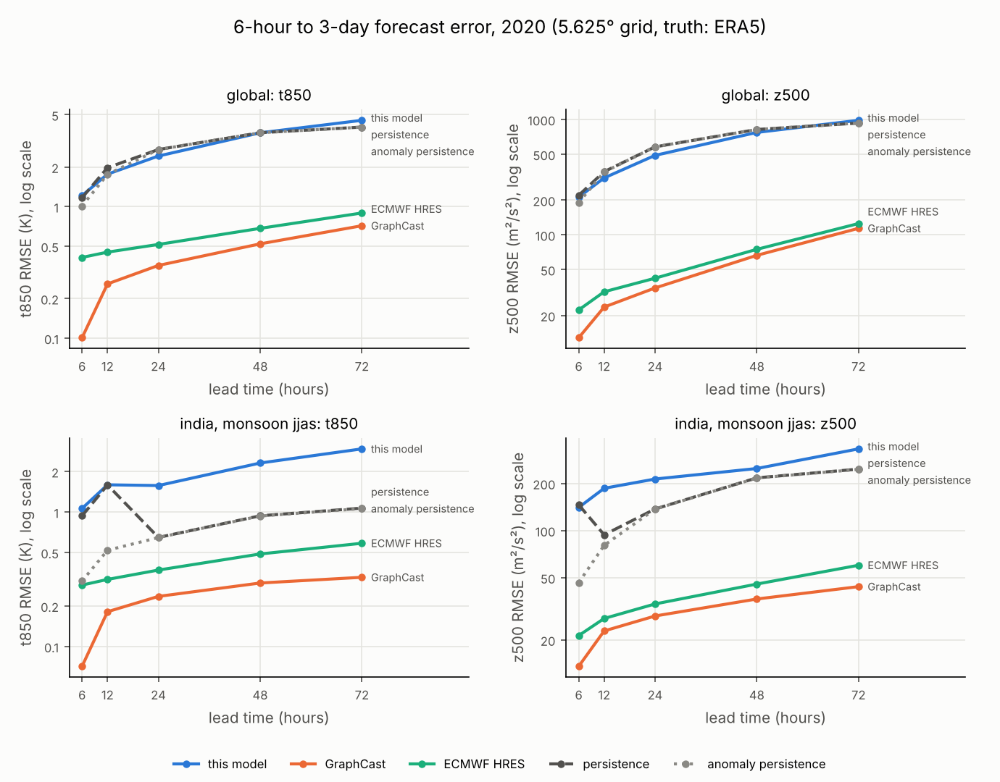
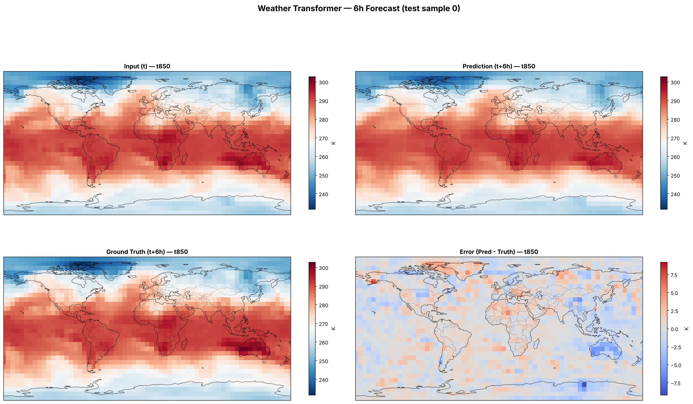

# Weather Transformer from Scratch

A Vision Transformer for 6-hour global weather forecasting, written from scratch in PyTorch and evaluated without shortcuts. The evaluation covers WeatherBench2-style metrics, regional scores for India, and a benchmark against GraphCast, ECMWF HRES, Pangu-Weather, FuXi, NeuralGCM and FGN (the model behind WeatherNext 2).

[](https://www.python.org/downloads/)
[](https://pytorch.org/)
[](https://opensource.org/licenses/MIT)
[](https://github.com/AswaniSahoo/weather-transformer-scratch/actions/workflows/ci.yml)

**[Read the technical report](docs/report.md)** for the findings, the method and the caveats.

## Highlights

- **Built from scratch:** patch embedding, positional encoding, multi-head self-attention (no `nn.MultiheadAttention`), transformer blocks and a physics-informed loss.
- **Evaluation that does not flatter:**
  - Area-weighted RMSE and ACC per variable, in physical units.
  - A climatology per day of year and hour, from the training years only.
  - Two baselines: persistence and anomaly persistence.
- **India:** scores over the Indian region, in the monsoon (June–September) and the rest of the year.
- **Benchmark:** six published models on the same grid, truth and metrics, from 6 hours to 3 days.
- **Reproducible:**
  - Seeded, resumable training.
  - CI on every pull request.
  - Every number in this README comes from a committed file in `results/` or `checkpoints/`.

## Results

Test year 2020, 6-hour forecasts, area-weighted. RMSE is in physical units. ACC is measured against a seasonal climatology from the training years (1 is perfect). Source: `results/metrics.json`.

**Global (1,463 forecasts)**

| Forecast | t850 RMSE (K) | z500 RMSE (m²/s²) | u10 RMSE (m/s) | v10 RMSE (m/s) | t850 ACC | z500 ACC | u10 ACC | v10 ACC |
|---|---:|---:|---:|---:|---:|---:|---:|---:|
| This model | 1.24 | 213 | 1.17 | 1.18 | 0.923 | 0.965 | 0.944 | 0.947 |
| Persistence | 1.20 | 221 | 1.49 | 1.81 | 0.932 | 0.962 | 0.907 | 0.875 |
| Anomaly persistence | 1.02 | 191 | 1.41 | 1.76 | 0.950 | 0.971 | 0.916 | 0.880 |

**India, June–September (488 forecasts)**

| Forecast | t850 RMSE (K) | z500 RMSE (m²/s²) | u10 RMSE (m/s) | v10 RMSE (m/s) | t850 ACC | z500 ACC | u10 ACC | v10 ACC |
|---|---:|---:|---:|---:|---:|---:|---:|---:|
| This model | 1.08 | 153 | 0.90 | 0.88 | 0.470 | 0.582 | 0.808 | 0.764 |
| Persistence | 0.88 | 148 | 0.88 | 0.88 | 0.663 | 0.702 | 0.848 | 0.805 |
| Anomaly persistence | 0.33 | 49 | 0.67 | 0.62 | 0.924 | 0.952 | 0.913 | 0.892 |

What this shows:
- **10 m wind:** the model beats both baselines globally. Its error is 22% (u10) and 35% (v10) lower than persistence's.
- **Temperature and pressure:** it does not beat anomaly persistence. t850 is 1.24 K against 1.02 K, and z500 is 213 against 191 m²/s².
- **India in the monsoon:**
  - The model is level with persistence on wind and behind it on t850 and z500.
  - Anomaly persistence beats it on every variable.
- **Why, and what to change:** see [section 6 of the report](docs/report.md#6-why-the-gap-is-so-large).

**Against published models** (702 forecasts started at 00 and 12 UTC in 2020; FGN: 2022)



| t850 RMSE (K) | 6 h | 24 h | 72 h |
|---|---:|---:|---:|
| This model, rolled forward | 1.21 | 2.43 | 4.54 |
| Persistence | 1.17 | 2.72 | 4.03 |
| GraphCast | 0.10 | 0.36 | 0.72 |
| ECMWF HRES* | 0.41 | 0.52 | 0.90 |
| FGN (WeatherNext 2), 2022* | 0.51 | 0.51 | 0.69 |

\*Starts from an operational analysis rather than ERA5, which adds to its short-range error. The [report](docs/report.md#5-against-published-models) covers this and the other caveats. Full tables: `results/benchmark_2020.md` and `results/benchmark_2022.md`.

**Training** (`checkpoints/training_log.json`)

| | |
|---|---|
| Parameters | 4,805,440 |
| Data | train 5,843 samples (2015–2018), validation 1,459 (2019), test 1,463 (2020) |
| Schedule | 50 epochs, batch 32, AdamW at 1e-4 with cosine decay, seed 42 |
| Best epoch | 48, validation loss 0.0690 (MSE 0.0368) |
| Hardware | 4-core CPU, about 2.5 hours, resumed across machine restarts |

The weights (58 MB with the optimizer state) are not committed. `python scripts/train.py --resume` reproduces the run.

**Sample forecast** (`results/figures/prediction_sample.png`)



*850 hPa temperature, 6 hours ahead from 1 January 2020, 00 UTC. Over Australia, at that hour mid-afternoon, the truth warmed by 1.9 K. The model predicted a cooling, missing by 2.8 K on average. It cannot see the time of day.*

## Architecture

```
Input (B, 4, 32, 64)          4 variables on a 32 x 64 latitude-longitude grid
   |
Patch embedding               4 x 4 patches -> 128 tokens of 256 dimensions
   |
+ Learned positional encoding
   |
6 x Transformer block         pre-norm, 8-head self-attention, MLP (4x), residuals
   |
Linear head + reshape         -> (B, 4, 32, 64): the state 6 hours later

4,805,440 parameters
```

## Project structure

```
weather-transformer-scratch/
├── configs/default.yaml           # Data, model, training and loss settings
├── scripts/
│   ├── train.py                   # Training entry point (--resume to continue a stopped run)
│   └── evaluation_pitfalls.py     # Measures how evaluation shortcuts change scores
├── src/
│   ├── data/                      # Download, preprocessing (arrays + sample times), Dataset
│   ├── models/                    # Patch embedding, attention, transformer block, model, loss
│   ├── training/trainer.py        # Training loop: seeding, checkpoints, resume
│   ├── evaluation/
│   │   ├── metrics.py             # Area-weighted RMSE, MAE, per-variable ACC
│   │   ├── evaluate.py            # Test-set scores: model, persistence, anomaly persistence
│   │   ├── regions.py             # Regions (India) and seasons (JJAS)
│   │   └── benchmark.py           # Scores WeatherBench2 forecasts and this model's rollouts
│   └── visualization/             # Forecast maps, loss curves, attention, benchmark figure
├── tests/                         # pytest suite, run by CI on every pull request
├── results/                       # Metrics, benchmark tables and figures (committed)
├── checkpoints/training_log.json  # History and settings of the reported run
└── docs/report.md                 # Technical report
```

## Quick start

```bash
git clone https://github.com/AswaniSahoo/weather-transformer-scratch.git
cd weather-transformer-scratch
python -m venv .venv
.venv\Scripts\activate          # Windows; on Linux/macOS: source .venv/bin/activate
pip install -r requirements-dev.txt
# For an NVIDIA GPU: pip install torch --index-url https://download.pytorch.org/whl/cu121
```

```bash
python -m src.data.download                  # ERA5 2015-2020 from WeatherBench2
python -m src.data.preprocessing             # normalized arrays and sample times
python scripts/train.py --resume             # 50 epochs, seed 42; continues if stopped
python -m src.evaluation.evaluate --figure results/figures/prediction_sample.png
python -m src.evaluation.benchmark --year 2020 --checkpoint checkpoints/best_model.pt
pytest && ruff check .
```

## Configuration

All settings live in `configs/default.yaml`, for example:

```yaml
data:
  variables:
    t850: {name: "temperature", level: 850}
    z500: {name: "geopotential", level: 500}
    u10: {name: "10m_u_component_of_wind"}
    v10: {name: "10m_v_component_of_wind"}
  train_years: [2015, 2018]
  lead_time_hours: 6

model: {patch_size: 4, embed_dim: 256, num_heads: 8, num_layers: 6, mlp_ratio: 4.0, dropout: 0.1}

training: {seed: 42, batch_size: 32, epochs: 50, learning_rate: 1.0e-4, checkpoint_dir: "checkpoints"}

loss: {mse_weight: 1.0, smoothness_weight: 0.1, conservation_weight: 0.05}
```

## Weather variables

| Variable | Description | Level | Unit |
|---|---|---|---|
| `t850` | Temperature | 850 hPa | K |
| `z500` | Geopotential | 500 hPa | m²/s² |
| `u10` | Eastward wind | 10 m | m/s |
| `v10` | Northward wind | 10 m | m/s |

## Testing

129 tests, run by GitHub Actions with lint on Python 3.10 and 3.12 for every pull request:

| Test file | Tests | Covers |
|---|---:|---|
| `test_model.py` | 51 | Patch embedding, positional encoding, attention, transformer block, model, physics loss |
| `test_metrics.py` | 23 | Area weights, RMSE, MAE, per-variable ACC, persistence |
| `test_data_pipeline.py` | 17 | Variable selection, axis order, lead time, grid check, sample times |
| `test_dataset.py` | 10 | Dataset loading, shapes, DataLoader |
| `test_benchmark.py` | 9 | WeatherBench2 stores, shared initializations, rollout, scoring, figure |
| `test_evaluate.py` | 7 | Seasonal climatology, anomaly persistence, regional scores, end-to-end run |
| `test_trainer.py` | 5 | Config handling, seeding, resuming a stopped run |
| `test_visualization.py` | 5 | Map longitudes, figure output |
| `test_regions.py` | 2 | India grid cells, months |

```bash
pytest                       # all tests
pytest tests/test_metrics.py -v
ruff check .
```

## Key components

**Physics-informed loss**

```
L = 1.0 x MSE + 0.1 x smoothness + 0.05 x conservation

MSE           error at every grid cell
Smoothness    penalizes large spatial gradients
Conservation  predicted global mean close to the target's
```

The smoothness term also penalizes real gradients. A perfect forecast would pay 0.051 in it, more than the model's whole validation MSE of 0.037, so the loss rewards blur (see the [technical report](docs/report.md#6-why-the-gap-is-so-large)).

**Multi-head self-attention, written by hand**

```python
Q, K, V = x @ W_q, x @ W_k, x @ W_v
attention = softmax(Q @ K.T / sqrt(d_k)) @ V    # per head, then concatenated
```

## References

1. Rasp et al. (2024). WeatherBench 2. [arXiv:2308.15560](https://arxiv.org/abs/2308.15560)
2. Lam et al. (2023). GraphCast. [arXiv:2212.12794](https://arxiv.org/abs/2212.12794)
3. Bi et al. (2023). Pangu-Weather. [Nature](https://doi.org/10.1038/s41586-023-06185-3)
4. Chen et al. (2023). FuXi. [arXiv:2306.12873](https://arxiv.org/abs/2306.12873)
5. Kochkov et al. (2024). NeuralGCM. [Nature](https://doi.org/10.1038/s41586-024-07744-y)
6. Alet et al. (2025). FGN, the model behind WeatherNext 2. [arXiv:2506.10772](https://arxiv.org/abs/2506.10772)
7. Pathak et al. (2022). FourCastNet. [arXiv:2202.11214](https://arxiv.org/abs/2202.11214)
8. Nguyen et al. (2023). ClimaX. [arXiv:2301.10343](https://arxiv.org/abs/2301.10343)
9. Dosovitskiy et al. (2020). Vision Transformer. [arXiv:2010.11929](https://arxiv.org/abs/2010.11929)
10. Vaswani et al. (2017). Attention Is All You Need. [arXiv:1706.03762](https://arxiv.org/abs/1706.03762)

## Author

**Aswani Sahoo**: [GitHub](https://github.com/AswaniSahoo) · [LinkedIn](https://linkedin.com/in/aswanisahoo)

## License

MIT; see [LICENSE](LICENSE).
