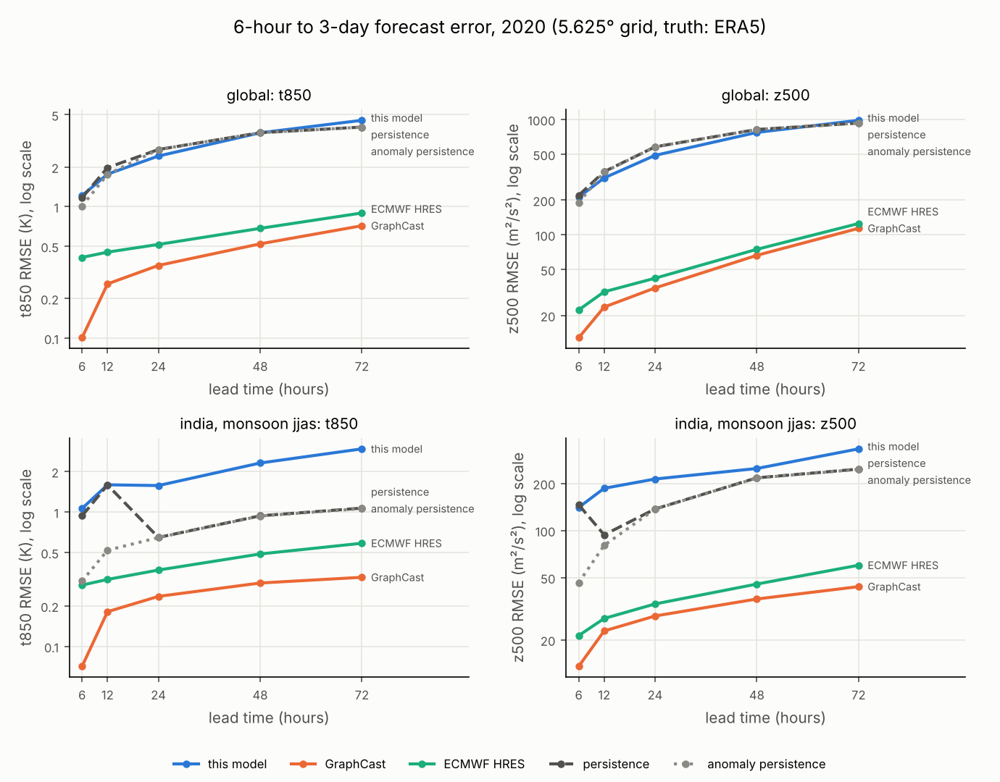

# A weather transformer from scratch: what it learns, and how to measure it honestly

Technical report for [weather-transformer-scratch](https://github.com/AswaniSahoo/weather-transformer-scratch). Every number below comes from a committed artifact in `results/` or `checkpoints/`, produced by the commands in [Reproduce](#reproduce).

## Summary

- **Evaluation shortcuts can hide or invent skill.** Five common shortcuts were measured on the same forecast. Example: one ACC pooled over all variables still scores a forecast whose 850 hPa temperature is exactly backwards at 0.71. A single yearly climatology instead of a seasonal one inflates t850 ACC from 0.93 to 0.97.
- **Persistence is a weak yardstick over India.** In the monsoon (June–September), the usual 6-hour change of t850 there is almost as large as the weather itself (0.82 K vs 0.94 K). Anomaly persistence keeps the input's departure from normal and adds the usual daily change. It cuts persistence's t850 error over India from 0.88 K to 0.33 K, so a model must beat anomaly persistence before it can claim skill there.
- **This model beats both baselines on 10 m wind, but not on temperature or pressure.**
  - Globally, its wind error is 22–35% below persistence's.
  - Anomaly persistence still beats it on t850 (1.02 K vs 1.24 K) and z500.
  - Over India in the monsoon, anomaly persistence beats it on every variable.
  - Rolled forward, it is ahead of persistence at 12 and 24 hours, level at 48 hours and behind at 72 hours.
- **Published models are far ahead.** On the same grid, truth and metrics, GraphCast's 6-hour t850 error is 0.10 K globally and 0.07 K over India in the monsoon. At 72 hours, the best published models (GraphCast, FuXi, NeuralGCM) are still more accurate than persistence is at 6 hours.

## 1. Setup

| | |
|---|---|
| Data | ERA5 from WeatherBench2 on a 5.625° grid (64 × 32), 6-hourly |
| Variables | t850 (temperature, 850 hPa), z500 (geopotential, 500 hPa), u10 and v10 (10 m wind) |
| Splits | train 2015–2018 (5,843 samples), validation 2019 (1,459), test 2020 (1,463) |
| Model | Vision Transformer written from scratch: 4×4 patches, 256-dim tokens, 6 pre-norm blocks with 8-head self-attention, linear head; 4,805,440 parameters |
| Task | predict the state 6 hours ahead from the current state |
| Loss | MSE + 0.1 × spatial smoothness + 0.05 × global-mean conservation |
| Training | AdamW, learning rate 1e-4 with cosine decay, 50 epochs, batch 32, seed 42; best epoch 48 (validation loss 0.0690); about 2.5 hours on a 4-core CPU |

**Evaluation**, the same for every forecast in this report:

- **Area weighting.** RMSE and ACC weight each grid cell by its area, cos(latitude).
- **ACC per variable and per forecast,** then averaged over forecasts.
- **Climatology** for ACC from the training years only, per day of year (±30-day window) and hour of day.
- **RMSE in physical units:** K, m²/s², m/s.
- **Two baselines:**
  - Persistence: the input state is the forecast.
  - Anomaly persistence: the input + the usual change from the input time to the target time.
- **Regions:** global, and India (cells whose centres lie in 6–38°N, 66–98°E: 6 × 6 cells, including neighbouring land and seas), split into the monsoon (June–September) and the rest of the year.

## 2. Evaluation pitfalls, measured

Each row scores the same forecast, persistence on the 2020 test set, with and without one shortcut (`results/evaluation_pitfalls.json`).

| Shortcut | What it does | Effect |
|---|---|---|
| No area weighting | Every cell counts the same, so the 10 rows nearest the poles (31% of cells, 12% of the Earth's area) are over-counted | Persistence RMSE 0.2681 → 0.2591 (normalized) once weighted |
| One pooled ACC | All variables in one correlation. Each variable counts by the size of its anomalies; the 10 m winds are 81% of that size | A forecast with t850 exactly backwards (per-variable ACC −0.975) still scores 0.71 |
| Test-year climatology | "The usual" is computed from the answers being graded | Changes ACC by at most 0.001 here, but makes scores depend on the test set |
| Yearly climatology | The same "usual" in January and July, so knowing the season counts as skill | t850 ACC 0.932 → 0.969, z500 0.962 → 0.977 |
| Persistence as the only baseline | Over India, the regular daily cycle counts as forecast error | India JJAS t850: persistence 0.88 K, anomaly persistence 0.33 K |

## 3. The daily cycle over India

Persistence copies the state from 6 hours earlier, which is a different time of day. Where the weather changes little but the daily cycle is strong, most of its error is the clock, not the weather.

India, June–September 2020 (RMS over the region, physical units):

| | t850 | z500 | u10 | v10 |
|---|---|---|---|---|
| Weather anomalies (truth − usual) | 0.94 K | 184 m²/s² | 1.71 m/s | 1.48 m/s |
| Usual 6-hour change | 0.82 K | 135 m²/s² | 0.56 m/s | 0.62 m/s |
| Persistence error | 0.88 K | 148 m²/s² | 0.88 m/s | 0.88 m/s |
| Anomaly persistence error | **0.33 K** | **49 m²/s²** | **0.67 m/s** | **0.62 m/s** |
| Persistence ACC → anomaly persistence ACC | 0.66 → 0.92 | 0.70 → 0.95 | 0.85 → 0.91 | 0.81 → 0.89 |

Globally the effect is small (t850 1.20 K → 1.02 K), because weather anomalies there (3.2 K) are much larger than the daily step (0.6 K).

The benchmark confirms the cause from a different angle. Over India in the monsoon, persistence's t850 error is **1.59 K at 12 hours but 0.65 K at 24 hours**: a 24-hour copy lands at the same time of day again. For z500, persistence is better at 12 hours (94 m²/s²) than at 6 hours (146), which points to a strong 12-hour rhythm in the pressure field over India, consistent with the sun-driven atmospheric tide.

## 4. This model against the baselines

The 2020 test set, 6-hour forecasts, from `results/metrics.json`. RMSE in physical units; ACC (1 is perfect).

**Global (1,463 forecasts)**

| Forecast | t850 RMSE (K) | z500 RMSE (m²/s²) | u10 RMSE (m/s) | v10 RMSE (m/s) | t850 ACC | z500 ACC | u10 ACC | v10 ACC |
|---|---:|---:|---:|---:|---:|---:|---:|---:|
| This model | 1.24 | 213 | 1.17 | 1.18 | 0.923 | 0.965 | 0.944 | 0.947 |
| Persistence | 1.20 | 221 | 1.49 | 1.81 | 0.932 | 0.962 | 0.907 | 0.875 |
| Anomaly persistence | 1.02 | 191 | 1.41 | 1.76 | 0.950 | 0.971 | 0.916 | 0.880 |

**India, June–September (488 forecasts)**

| Forecast | t850 RMSE (K) | z500 RMSE (m²/s²) | u10 RMSE (m/s) | v10 RMSE (m/s) | t850 ACC | z500 ACC | u10 ACC | v10 ACC |
|---|---:|---:|---:|---:|---:|---:|---:|---:|
| This model | 1.08 | 153 | 0.90 | 0.88 | 0.470 | 0.582 | 0.808 | 0.764 |
| Persistence | 0.88 | 148 | 0.88 | 0.88 | 0.663 | 0.702 | 0.848 | 0.805 |
| Anomaly persistence | 0.33 | 49 | 0.67 | 0.62 | 0.924 | 0.952 | 0.913 | 0.892 |

**India, rest of the year (975 forecasts)**

| Forecast | t850 RMSE (K) | z500 RMSE (m²/s²) | u10 RMSE (m/s) | v10 RMSE (m/s) | t850 ACC | z500 ACC | u10 ACC | v10 ACC |
|---|---:|---:|---:|---:|---:|---:|---:|---:|
| This model | 1.29 | 173 | 0.98 | 0.83 | 0.721 | 0.752 | 0.708 | 0.741 |
| Persistence | 1.05 | 171 | 1.00 | 0.81 | 0.841 | 0.809 | 0.763 | 0.798 |
| Anomaly persistence | 0.50 | 62 | 0.64 | 0.63 | 0.960 | 0.970 | 0.879 | 0.865 |

What this shows:

- **10 m wind** is where the model learned something baselines cannot do. Globally its error is 22% (u10) and 35% (v10) below persistence, and 18% and 33% below anomaly persistence.
- **t850** is 3% worse than persistence and 21% worse than anomaly persistence. **z500** is 4% better than persistence and 11% worse than anomaly persistence.
- **Over India** the model is behind anomaly persistence on every variable in both seasons. In the monsoon its t850 error is three times anomaly persistence's (1.08 K vs 0.33 K).
- **The sample map** in `results/figures/prediction_sample.png` (1 January 2020, 00 → 06 UTC) shows one reason. Over Australia, where it is mid-afternoon, the truth warmed by 1.9 K on average and the model predicted a cooling, missing by 2.8 K. This is consistent with a model that cannot see the time of day.

## 5. Against published models

WeatherBench2 hosts forecasts from published models, regridded to the same 5.625° grid. They are scored here with the same truth (ERA5), metrics and climatology, from 702 shared initializations in 2020 (00 and 12 UTC, 1 January to 16 December). FGN, the model behind Google DeepMind's WeatherNext 2, is only available for 2022 (724 initializations). This model is rolled forward 6 hours per step from the same ERA5 starting states.



**RMSE at 6 h / 24 h / 72 h**

| Forecast | Global t850 (K) | Global z500 (m²/s²) | India JJAS t850 (K) | India JJAS z500 (m²/s²) |
|---|---|---|---|---|
| This model, rolled forward | 1.21 / 2.43 / 4.54 | 212 / 489 / 984 | 1.06 / 1.57 / 2.95 | 140 / 213 / 333 |
| Persistence | 1.17 / 2.72 / 4.03 | 220 / 579 / 932 | 0.94 / 0.65 / 1.07 | 146 / 137 / 247 |
| Anomaly persistence | 1.01 / 2.72 / 4.02 | 191 / 579 / 931 | 0.31 / 0.65 / 1.06 | 46 / 137 / 246 |
| GraphCast | 0.10 / 0.36 / 0.72 | 13 / 35 / 114 | 0.07 / 0.24 / 0.33 | 14 / 28 / 44 |
| FuXi | 0.12 / 0.37 / 0.73 | 14 / 35 / 114 | 0.07 / 0.23 / 0.33 | 15 / 28 / 46 |
| NeuralGCM (from 12 h) | – / 0.38 / 0.72 | – / 33 / 105 | – / 0.27 / 0.37 | – / 28 / 42 |
| Pangu-Weather | 0.14 / 0.41 / 0.80 | 13 / 39 / 123 | 0.10 / 0.26 / 0.36 | 13 / 35 / 49 |
| ECMWF HRES | 0.41 / 0.52 / 0.90 | 22 / 42 / 125 | 0.29 / 0.37 / 0.59 | 21 / 34 / 60 |
| *2022:* FGN (WeatherNext 2) | 0.51 / 0.51 / 0.69 | 23 / 34 / 97 | 0.24 / 0.30 / 0.40 | 19 / 26 / 39 |
| *2022:* this model | 1.20 / 2.40 / 4.54 | 211 / 478 / 965 | 1.08 / 1.66 / 2.87 | 138 / 218 / 337 |

The 6-hour numbers for this model differ slightly from section 4 because the benchmark uses only the 702 forecasts started at 00 and 12 UTC. On 2022, a year it never saw, the model scores about the same as on 2020.

Full tables: `results/benchmark_2020.md` and `results/benchmark_2022.md`.

**Read these comparisons with three caveats:**

- **Coarse grid.** The published models run at 0.25° or finer; averaged onto 5.625°, their scores show skill at this coarse scale only.
- **Different starting analysis.** ECMWF HRES starts from ECMWF's own analysis, not ERA5. Part of its short-range error against ERA5 is the difference between the two analyses, which is why WeatherBench2 scores HRES against its own analysis. FGN's error is nearly flat from 6 to 24 hours, which suggests it also starts from an operational analysis. Compare these two with the ERA5-started models at longer lead times, not at 6–12 hours.
- **Different year.** FGN's 2022 numbers are not directly comparable with the 2020 rows.

## 6. Why the gap is so large

Five differences explain most of it. The first four can be changed within this project.

1. **The model cannot see the clock.**
   - Its only input is the current state of four fields. GraphCast also receives the incoming solar radiation at every grid point.
   - Over India, where the daily cycle is about as large as the weather, a forecast that knows the clock (anomaly persistence) has a third of this model's t850 error.
   - The Australia example in section 4 shows the same failure.
2. **It rebuilds the whole state at every step.**
   - It outputs the full field, not the change. Every small error in the parts that barely move counts in full, while persistence gets those parts exactly right.
   - This is the likely reason it is behind persistence on t850 even at 6 hours.
   - Predicting the change instead (tendency prediction) is being tested now (step 6 of the roadmap).
3. **Its loss rewards blur.**
   - The smoothness term penalizes the truth's own gradients.
   - On the validation set, a perfect forecast would pay 0.051 in it. That is more than the model's whole validation MSE of 0.037 (`results/evaluation_pitfalls.json`, `checkpoints/training_log.json`).
4. **It is trained for one step only.**
   - Rolled forward, its errors feed back into its inputs. Its t850 error grows from 1.21 K at 6 hours to 4.54 K at 72 hours, above persistence's 4.03 K.
   - GraphCast is fine-tuned on rollouts of up to 3 days, so it learns to correct its own drift.
5. **It sees far less.**
   - This model: four fields on two levels, from one time step, trained on four years at 5.625°.
   - GraphCast: six variables on 37 pressure levels plus five surface variables, from the two latest time steps, trained on 39 years of ERA5 at 0.25°.

## 7. Limitations

- **One seed per configuration.** Run-to-run noise was not measured; only differences well above it should be trusted.
- **CPU budget.** Training ran on a 4-core CPU (about 3 hours for 50 epochs), which limited how many configurations could be tried.
- **A coarse grid and a box-shaped region.** The India box also covers parts of neighbouring countries, the Arabian Sea and the Bay of Bengal. Over the Himalayas, 850 hPa lies below the ground, so those cells hold values ERA5 extrapolates below the surface.
- **ERA5 is the truth for every forecast,** which disadvantages models that start from other analyses at short lead times (see section 5).

## 8. Next steps

- **Tendency prediction:** predict the 6-hour change instead of the full state, with and without the smoothness and conservation terms. The training runs for this ablation are under way.
- **The clock as an input:** add the incoming solar radiation (or the time of day and year) to the inputs.
- **Inputs that carry the physics:** winds and humidity at 850 and 500 hPa, so that t850 can be advected.
- **Training over several steps,** so that rollouts beyond 6 hours stay stable.
- **WeatherNext 3 at full resolution over India,** and verification against IMD station and gridded observations rather than ERA5 alone.

## Reproduce

```bash
pip install -r requirements-dev.txt
python -m src.data.download                      # ERA5 2015-2020 from WeatherBench2
python -m src.data.preprocessing                 # normalized arrays and sample times
python scripts/train.py --resume                 # 50 epochs, seed 42; continues if stopped
python -m src.evaluation.evaluate --figure results/figures/prediction_sample.png
python -m src.evaluation.benchmark --year 2020 --checkpoint checkpoints/best_model.pt --figure results/figures/benchmark_2020.png
python -m src.evaluation.benchmark --year 2022 --models fgn --checkpoint checkpoints/best_model.pt
python scripts/evaluation_pitfalls.py
```

## References

- Rasp et al. (2024). WeatherBench 2: A benchmark for the next generation of data-driven global weather models. [arXiv:2308.15560](https://arxiv.org/abs/2308.15560)
- Lam et al. (2023). Learning skillful medium-range global weather forecasting (GraphCast). [arXiv:2212.12794](https://arxiv.org/abs/2212.12794)
- Bi et al. (2023). Accurate medium-range global weather forecasting with 3D neural networks (Pangu-Weather). [Nature](https://doi.org/10.1038/s41586-023-06185-3)
- Chen et al. (2023). FuXi: a cascade machine learning forecasting system for 15-day global weather forecast. [arXiv:2306.12873](https://arxiv.org/abs/2306.12873)
- Kochkov et al. (2024). Neural general circulation models for weather and climate (NeuralGCM). [Nature](https://doi.org/10.1038/s41586-024-07744-y)
- Alet et al. (2025). Skillful joint probabilistic weather forecasting from marginals (FGN). [arXiv:2506.10772](https://arxiv.org/abs/2506.10772)
- Hersbach et al. (2020). The ERA5 global reanalysis. [QJRMS](https://doi.org/10.1002/qj.3803)
